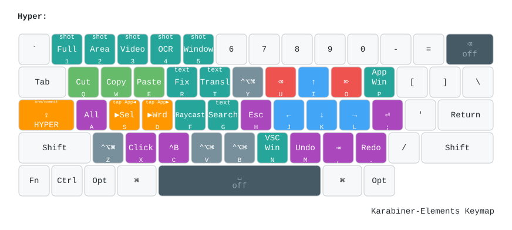
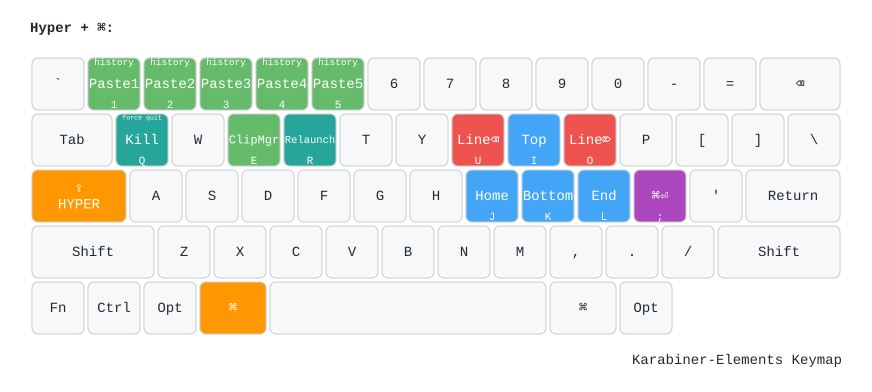
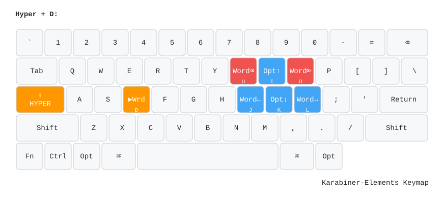
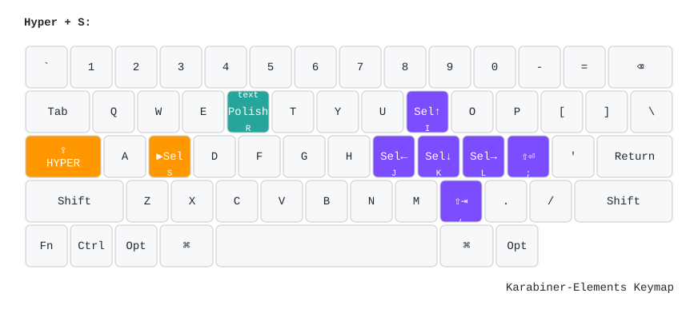
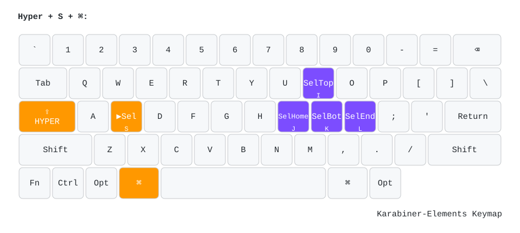
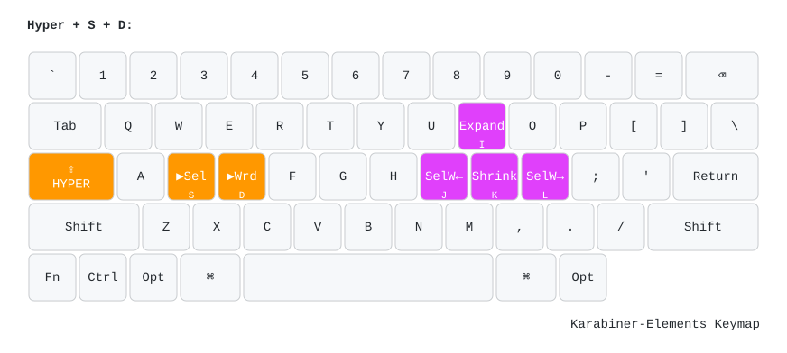
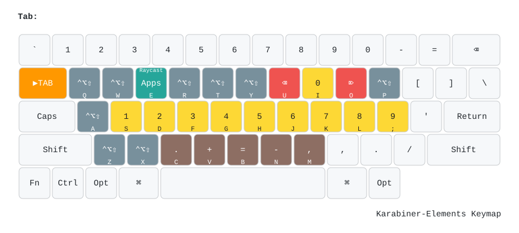
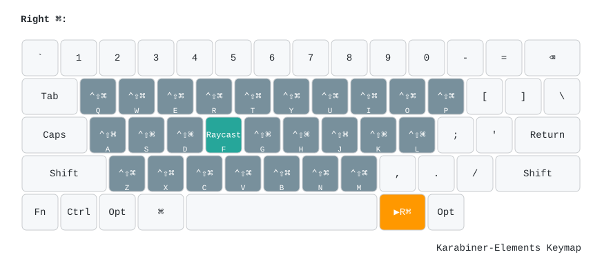
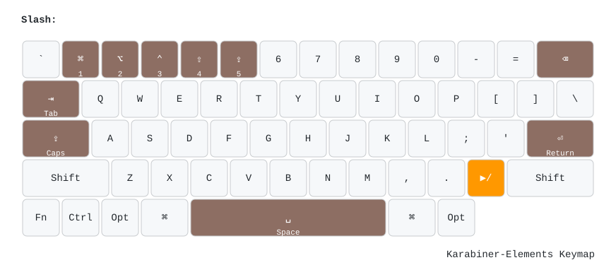
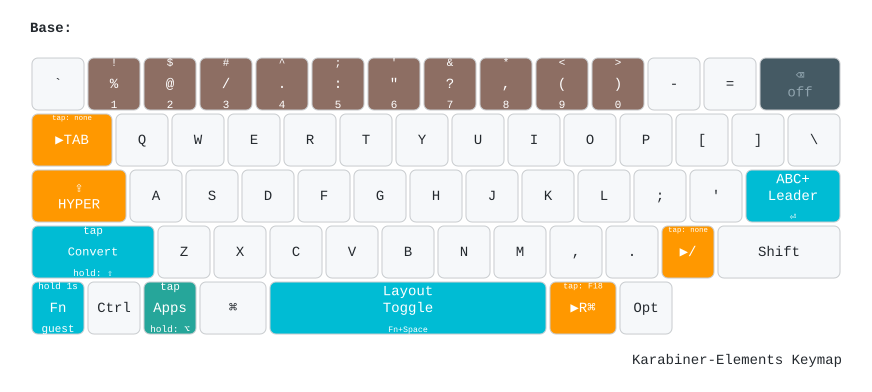

# Karabiner-Elements Keymap

Custom keyboard layout built with Karabiner-Elements. CapsLock is remapped to a **Hyper key** that activates vim-style navigation, deletion, clipboard, selection and app-switching layers. Tab, right ⌘ and `/` are layer keys too: held, they turn the keyboard into a digit pad, a launcher layer and a key-glyph layer.

Drawings are positional: legends show what a physical key (QWERTY position, bottom label) does in the layer. Keys outside the 60% ANSI drawing (Esc, arrows, Forward Delete) are listed in the tables only.

## Color Legend

| Color | Category |
|-------|----------|
| Blue `#42a5f5` | Navigation |
| Red `#ef5350` | Deletion |
| Green `#66bb6a` | Clipboard |
| Purple `#ab47bc` | System |
| Orange `#ff9800` | Layer Activator |
| Dark `#455a64` | Disabled |
| Deep Purple `#7c4dff` | Selection |
| Pink `#e040fb` | Word Selection |
| Cyan `#00bcd4` | Remap |
| Teal `#26a69a` | Apps & Windows |
| Yellow `#fdd835` | Digits |
| Brown `#8d6e63` | Symbols & Glyphs |

---

## Layers

Every layer is checked against all the others: a Hyper bind fires only while S, D, Tab and right ⌘ are not held, a Hyper + S bind only while D is not held, and so on. Holding a second layer key therefore switches to that layer instead of mixing binds.

### 1. Hyper Layer (`⇪` CapsLock held)

Main layer. Vim-style navigation (IJKL), deletion (UO), clipboard (QWE), screenshots on the number row, window pickers and system shortcuts.

CapsLock also drives the Hammerspoon app switcher: pressing it sends the *arm* chord, releasing it sends the *commit* chord. While CapsLock is held, tapping `S` or `D` alone steps the switcher to the previous or next app; releasing CapsLock switches to the selected app. Holding `S` or `D` instead activates the Selection or Word layer.



| Key | Action | Category |
|-----|--------|----------|
| `⇪+I/J/K/L` | ↑/←/↓/→ | Navigation |
| `⇪+U` | Backspace | Deletion |
| `⇪+O` | Forward Delete | Deletion |
| `⇪+Q` | Cut (⌘X) | Clipboard |
| `⇪+W` | Copy (⌘C) | Clipboard |
| `⇪+E` | Paste (⌘V) | Clipboard |
| `⇪+A` | Select All (⌘A) | System |
| `⇪+H` | Escape | System |
| `⇪+;` | Enter | System |
| `⇪+,` | Tab | System |
| `⇪+M` | Undo (⌘Z) | System |
| `⇪+.` | Redo (⌘⇧Z) | System |
| `⇪+X` | Mouse left click | System |
| `⇪+C` | tmux prefix (⌃B) | System |
| `⇪+F` | Raycast | Apps & Windows |
| `⇪+P` | Windows of the current app (Hammerspoon) | Apps & Windows |
| `⇪+N` | VS Code windows (Raycast app switcher) | Apps & Windows |
| `⇪+1` | Screenshot: full screen (CleanShot) | Apps & Windows |
| `⇪+2` | Screenshot: area | Apps & Windows |
| `⇪+3` | Screen recording | Apps & Windows |
| `⇪+4` | Capture text (OCR) | Apps & Windows |
| `⇪+5` | Screenshot: window | Apps & Windows |
| `⇪+⎋` | Force Quit dialog (⌘⌥⎋) | Apps & Windows |
| `⇪+Space` | Nothing (swallowed) | Disabled |
| `⇪` press / release | App switcher arm / commit (Hammerspoon) | Layer |
| `⇪+S` tap / hold | Previous app in switcher / Selection layer | Layer |
| `⇪+D` tap / hold | Next app in switcher / Word layer | Layer |

---

### 2. Hyper + ⌘ Layer (`⇪` + `⌘` held)

Line/page-level navigation, line deletion, clipboard history, quitting apps and ⌘+Enter.



| Key | Action | Category |
|-----|--------|----------|
| `⇪+⌘+I` | Top of document (⌘↑) | Navigation |
| `⇪+⌘+K` | Bottom of document (⌘↓) | Navigation |
| `⇪+⌘+J` | Line start (⌘←) | Navigation |
| `⇪+⌘+L` | Line end (⌘→) | Navigation |
| `⇪+⌘+U` | Delete to line start (⌘⌫) | Deletion |
| `⇪+⌘+O` | Delete to line end (⌘⌦) | Deletion |
| `⇪+⌘+E` | Clipboard manager (⌘⇧V) | Clipboard |
| `⇪+⌘+1…5` | Paste the 1st…5th most recent clipboard item (Hammerspoon) | Clipboard |
| `⇪+⌘+;` | ⌘+Enter | System |
| `⇪+⌘+Q` | Kill the frontmost app (`kill -9`) | Apps & Windows |
| `⇪+⌘+R` | Kill and relaunch the frontmost app | Apps & Windows |

---

### 3. Hyper + D Layer (`⇪` + `D` held — Word Level)

Word-level navigation and deletion. Hold CapsLock + D, then use IJKL/UO.



| Key | Action | Category |
|-----|--------|----------|
| `⇪+D+J` | Word left (⌥←) | Navigation |
| `⇪+D+L` | Word right (⌥→) | Navigation |
| `⇪+D+I` | Option+Up (⌥↑) | Navigation |
| `⇪+D+K` | Option+Down (⌥↓) | Navigation |
| `⇪+D+U` | Delete word backward (⌥⌫) | Deletion |
| `⇪+D+O` | Delete word forward (⌥⌦) | Deletion |

---

### 4. Hyper + S Layer (`⇪` + `S` held — Selection)

Character-level selection with IJKL, plus shifted Enter and Tab.



| Key | Action | Category |
|-----|--------|----------|
| `⇪+S+J` | Select left (⇧←) | Selection |
| `⇪+S+L` | Select right (⇧→) | Selection |
| `⇪+S+I` | Select up (⇧↑) | Selection |
| `⇪+S+K` | Select down (⇧↓) | Selection |
| `⇪+S+;` | Shift+Enter (⇧⏎) | Selection |
| `⇪+S+,` | Shift+Tab (⇧⇥) | Selection |

---

### 5. Hyper + S + ⌘ Layer (`⇪` + `S` + `⌘` held — Line Selection)

Selection to line and document boundaries.



| Key | Action | Category |
|-----|--------|----------|
| `⇪+S+⌘+J` | Select to line start (⌘⇧←) | Selection |
| `⇪+S+⌘+L` | Select to line end (⌘⇧→) | Selection |
| `⇪+S+⌘+I` | Select to top of document (⌘⇧↑) | Selection |
| `⇪+S+⌘+K` | Select to bottom of document (⌘⇧↓) | Selection |

---

### 6. Hyper + S + D Layer (`⇪` + `S` + `D` held — Word Selection)

Word-level selection. I/K control VS Code selection expand/shrink.



| Key | Action | Category |
|-----|--------|----------|
| `⇪+S+D+J` | Select word left (⌥⇧←) | Word Selection |
| `⇪+S+D+L` | Select word right (⌥⇧→) | Word Selection |
| `⇪+S+D+I` | Expand selection (⌃⇧⌘→) | Word Selection |
| `⇪+S+D+K` | Shrink selection (⌃⇧⌘←) | Word Selection |

---

### 7. Tab Layer (`⇥` Tab held)

Tab is a pure layer key: tapping it types nothing (Tab itself is `⇪+,`). Held, the right hand becomes a digit pad, and `E` opens the Raycast app switcher.

`Tab+E` also suspends the layer until Tab is released, so the keys typed while the switcher is open reach Raycast unchanged.



| Key | Action | Category |
|-----|--------|----------|
| `⇥+U/I/O` | 1 / 2 / 3 | Digits |
| `⇥+J/K/L` | 4 / 5 / 6 | Digits |
| `⇥+M/,/.` | 7 / 8 / 9 | Digits |
| `⇥+;` | 0 | Digits |
| `⇥+E` | Raycast app switcher (same chord as a left ⌥ tap) | Apps & Windows |

---

### 8. Right ⌘ Layer (right `⌘` held)

Right ⌘ no longer acts as Command. Tapped alone it sends F18 (global leader key); held, it activates this layer.



| Key | Action | Category |
|-----|--------|----------|
| right `⌘` tap | F18 (global leader) | Layer |
| `R⌘+F` | Raycast | Apps & Windows |

---

### 9. Slash Layer (`/` held)

Types key glyphs: while `/` is held, a key pastes its own symbol (through the clipboard, which is restored afterwards). Tapping `/` alone types nothing; `/` itself is on the number row (`3`).



| Key | Glyph | Category |
|-----|-------|----------|
| `/+1` | ⌘ | Symbols & Glyphs |
| `/+2` | ⌥ | Symbols & Glyphs |
| `/+3` | ⌃ | Symbols & Glyphs |
| `/+4` | ⇧ | Symbols & Glyphs |
| `/+5`, `/+⇪` | ⇪ | Symbols & Glyphs |
| `/+Space` | ␣ | Symbols & Glyphs |
| `/+⏎` | ⏎ | Symbols & Glyphs |
| `/+⇥` | ⇥ | Symbols & Glyphs |
| `/+⌫` | ⌫ | Symbols & Glyphs |
| `/+⎋` | ⎋ | Symbols & Glyphs |
| `/+⌦` | ⌦ | Symbols & Glyphs |
| `/+←/→/↑/↓` | ← / → / ↑ / ↓ | Symbols & Glyphs |

---

### 10. Base Modifications (Non-Layer Remaps)

Standalone key remaps and disabled keys, active without holding a layer key.



| Key | Action | Category |
|-----|--------|----------|
| `1`…`0` | Symbols, see [Number Row Symbols](#number-row-symbols) | Symbols & Glyphs |
| `⏎` (Return) | Switch to ABC + in-app leader chord | Remap |
| Left `⇧` tap | Left ⌃ (KeySwitcher convert trigger) | Remap |
| Left `⌥` tap | Raycast app switcher (⌘⌥⌃⇧\\) | Apps & Windows |
| Right `⌘` | Right ⌘ layer, tap: F18 (global leader) | Layer |
| `Fn+Space` | Toggle QWERTY/Colemak layout | Remap |
| Hold `Fn` 1 s | Toggle Guest Mode | Remap |
| `⌘⇧⎋` | Reset all layers and the layout | Remap |
| Hold `⇪` | Hyper layer | Layer |
| Hold `⇥` | Tab layer (tap: nothing) | Layer |
| Hold `/` | Slash layer (tap: nothing) | Layer |
| `⌫` (Backspace) | Disabled | Disabled |
| `←` `→` `↑` `↓` | Disabled | Disabled |

---

## Additional Features

### Disabled Standard Shortcuts

These common shortcuts are disabled to enforce layer usage:

| Shortcut | Replaced by |
|----------|-------------|
| `⌘A` (Select All) | `⇪+A` |
| `⌘C` (Copy) | `⇪+W` |
| `⌘V` (Paste) | `⇪+E` |
| `⌘X` (Cut) | `⇪+Q` |
| `⌘Z` (Undo) | `⇪+M` |
| `⌘⇥` / `⌘⇧⇥` (App Switcher) | `⇪` + `S`/`D` taps, left `⌥` tap, `⇥+E` |
| `` ⌘` `` / `` ⌘⇧` `` (Cycle Windows) | `⇪+P` |
| `⇧/` (`?`) | Number row `7` |
| `⌫` (Backspace) | `⇪+U` |
| Arrow keys | `⇪+I/J/K/L` |

### Number Row Symbols

The digit keys type symbols; digits come from the Tab layer. Each symbol is typed correctly in both the ABC and the Russian input source: when Russian has no key for a symbol, the key briefly switches to ABC and back.

| Key | `1` | `2` | `3` | `4` | `5` | `6` | `7` | `8` | `9` | `0` |
|-----|-----|-----|-----|-----|-----|-----|-----|-----|-----|-----|
| Plain | `%` | `@` | `/` | `.` | `:` | `"` | `?` | `,` | `(` | `)` |
| `⇧` | `!` | `$` | `#` | `^` | `;` | `'` | `&` | `*` | `<` | `>` |

### Colemak Layout (`Fn+Space` toggle)

`Fn+Space` toggles between QWERTY and Colemak (a notification shows the active layout). The remap applies only while the ABC input source is active, and works with and without Shift. When Colemak mode is active, alpha keys remap:

```
QWERTY:  Q  W  E  R  T  Y  U  I  O  P
Colemak: Q  W  F  P  B  J  L  U  Y  ;

QWERTY:  A  S  D  F  G  H  J  K  L  ;
Colemak: A  R  S  T  G  M  N  E  I  O

QWERTY:  Z  X  C  V  B  N  M
Colemak: X  C  D  V  Z  K  H
```

A `colemak-angle` variant (bottom row `Z X C D V K H`) is defined as well but has no toggle bound.

### Guest Mode (hold `Fn` 1 s)

Holding Fn for one second switches every rule off and leaves a stock keyboard: layers and the layout are reset, KeySwitcher is quit, and a notification confirms. Holding Fn again restores the keymap and relaunches KeySwitcher.

### Reset (`⌘⇧⎋`)

Clears every layer variable (Hyper, S, D, Tab, right ⌘, Slash, the Tab-layer suspension) and resets the layout to QWERTY, in case a layer gets stuck.
